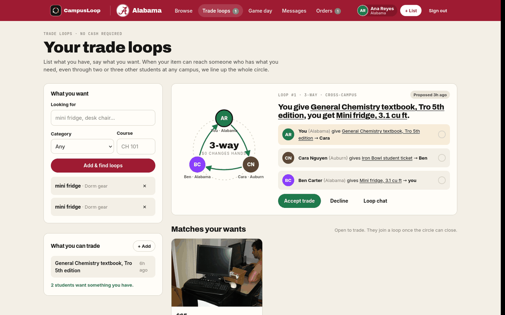
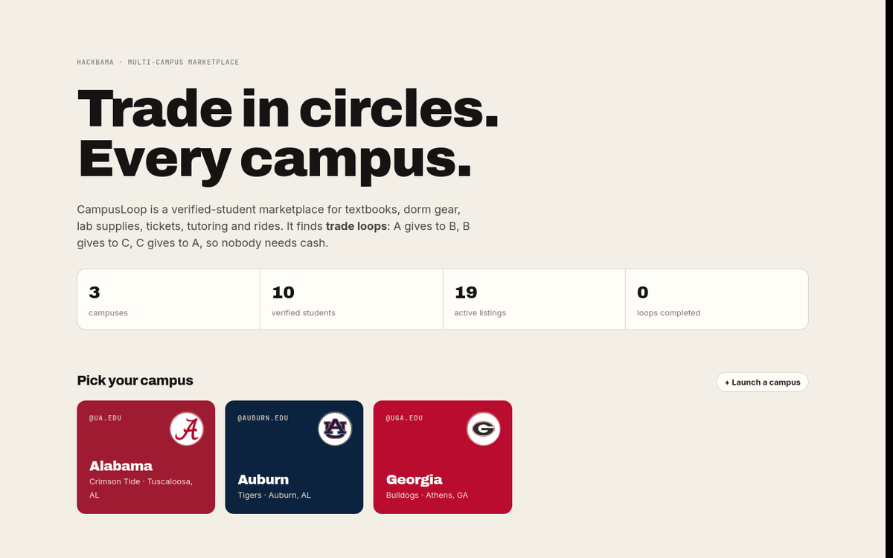
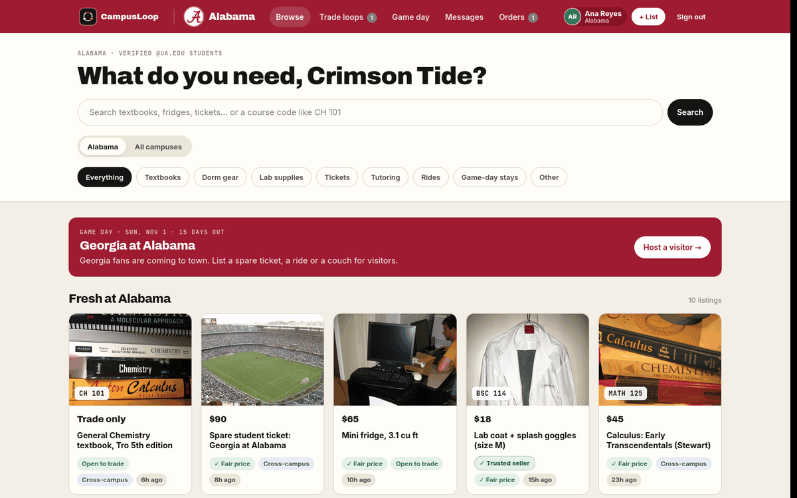
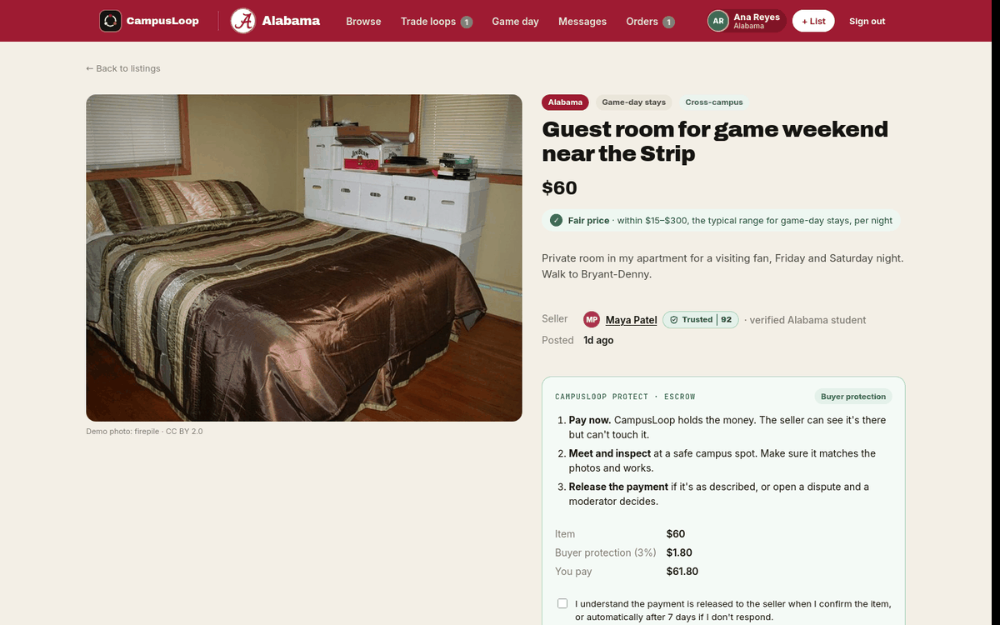
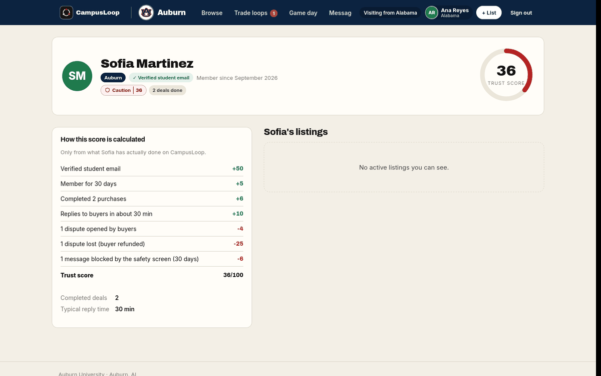
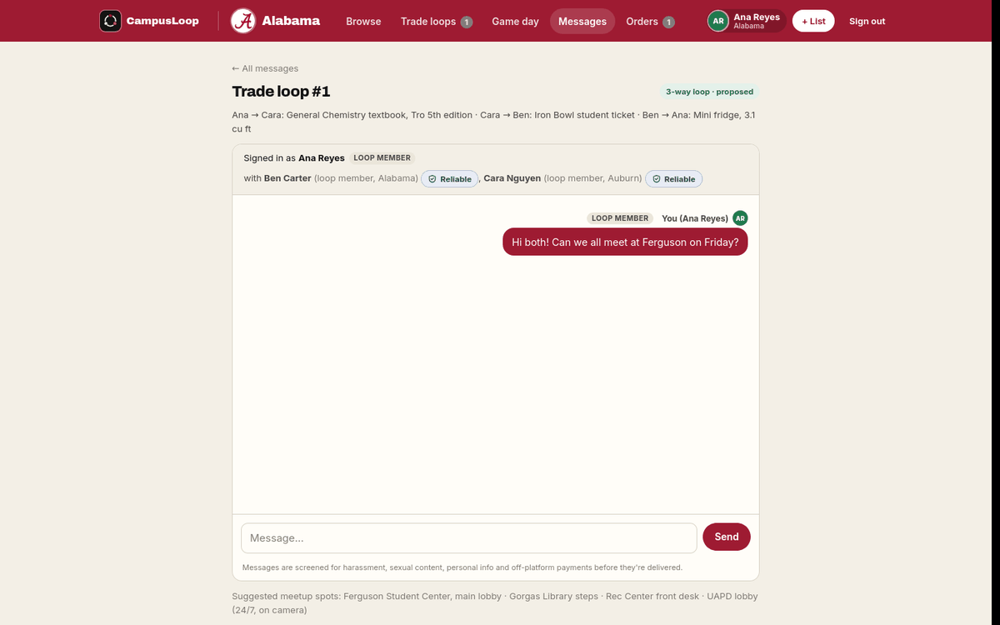
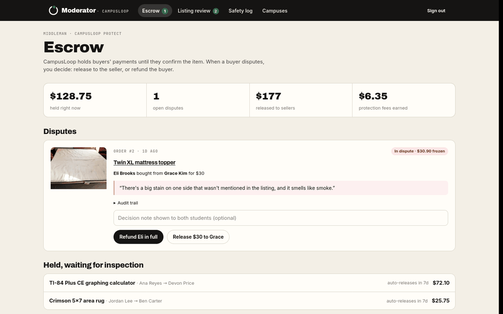
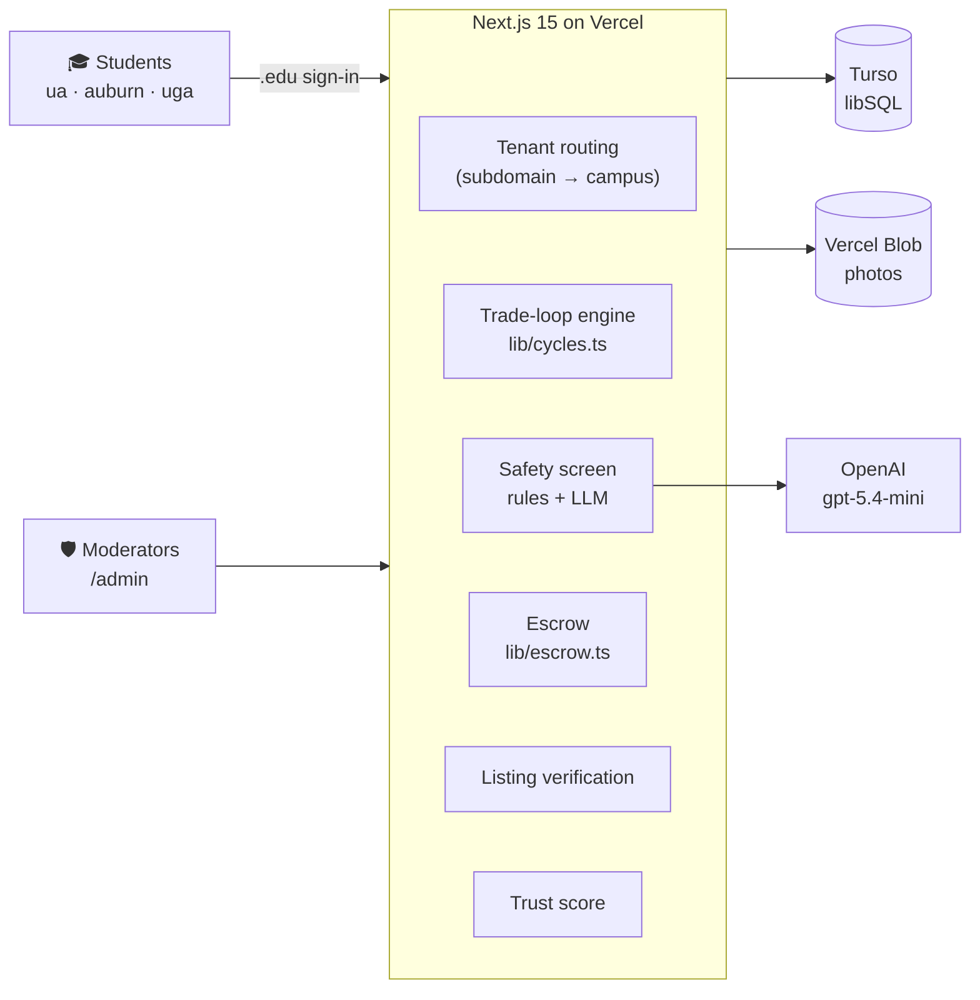

<div align="center">

<picture>
  <source media="(prefers-color-scheme: dark)" srcset="public/brand/campusloop-logo-dark.svg">
  
</picture>

### Trade in circles. Every campus.

The verified-student marketplace where nobody needs cash.

[](https://campusloop-gold.vercel.app)
[](https://github.com/kejihela/HackBama)


-4FF8D2?logo=turso&logoColor=black)


</div>

---

## 🏆 HackBama submission

| | |
|---|---|
| **Project** | CampusLoop |
| **Team** | BARK |
| **Members** | Ridwan Bello · Adebayo Abdulganiyu Keji |
| **Track** | Track 1 (Styslinger College of Engineering) |
| **Live demo** | **https://campusloop-gold.vercel.app** |
| **GitHub** | https://github.com/kejihela/HackBama |

## 📌 Short description

CampusLoop is a SaaS multi-campus marketplace for verified college students to buy, sell and trade items like textbooks, dorm gear, tickets, tutoring and rides. Its core idea is the **trade loop**: the app finds swap chains like A → B → C → A, so students can trade without cash, even across schools. Every deal is protected by an **AI safety screen**, **escrow payments** and a transparent **trust score**.

<div align="center">
  
  <br><sub>A real 3-way loop: Ana’s chem book goes to Cara at Auburn, Cara’s Iron Bowl ticket goes to Ben, and Ben’s mini fridge goes to Ana. $0 changes hands.</sub>
</div>

---

## ✨ Features

### 🔄 Trade loops: the core idea
Students list what they have and say what they want. CampusLoop builds a graph of *who could give what to whom* and finds cycles of 2–4 students, the same structure kidney-exchange programs use for donor chains. Every member accepts, the loop locks in, and a group chat opens. The matcher re-runs whenever anyone lists or wants something, across campuses.

### 🛡️ AI safety screen
Every chat message and listing is checked **on the server, before anyone sees it**:
- **Rules first:** phone numbers, emails, card numbers and obfuscated spellings (`n u d e s`, `s3xy`) are caught instantly.
- **Then an LLM** (OpenAI `gpt-5.4-mini`, or Claude) judges meaning. It catches *“box of 9mm rounds”* or *“be careful walking home alone tonight”*, and lets through harmless messages a keyword filter would block.
- **Categories:** sexual content, harassment, personal info, off-platform payment scams, prohibited items, offensive content.
- **Blocked messages are never delivered.** The sender sees a caution, and 5 blocks in 24 hours pauses messaging.
- **Precision:** only high-confidence calls block. Unsure ones are delivered and queued for a moderator. If the model is slow or down, the rules decide.

### 💰 Escrow: CampusLoop as the middleman
Like Upwork for campus deals:
1. The buyer pays into escrow.
2. They meet at a safe campus spot and inspect the item.
3. They **release** the payment, or **open a dispute** that a moderator resolves.

Payment auto-releases after 7 days, every step is in an audit trail, and a 3% buyer-protection fee applies. Payments are simulated in demo mode.

### ✅ Listing verification
Drugs, vapes, weapons, alcohol, fake IDs and test banks are rejected. Prices are checked against similar listings and typical used prices. Overpriced or *suspiciously cheap* items (a classic scam) go to a moderator. Sellers see a live **fair-price check** as they type.

### ⭐ Trust score
A 0–100 score built only from real behavior: completed deals, reply speed, disputes, cancellations and blocked messages. Every point is explained on the student’s profile.

### 🏈 Game Day, cross-campus
When Alabama plays at Auburn, Alabama students see Auburn students’ spare tickets, rides and couches for the weekend. Any listing can be shared with every campus.

### 🏫 Multi-tenant SaaS
One deployment serves every university. Each campus is a tenant with its own logo, colors, .edu domains, categories and safe meetup spots. **A new school launches from one admin form**, with no code and no redeploy.

---

## 📸 Screenshots

| Campus selection | Browse (signed in) |
|---|---|
|  |  |
| **Listing with escrow and a Trusted seller** | **Trust score breakdown** |
|  |  |
| **Trade-loop chat with names, roles and trust** | **Moderator escrow console** |
|  |  |

---

## 🧭 How it works



- **Tenant isolation:** every row carries `tenant_id`, and one visibility rule governs every listing read. Students see their own campus plus anything other schools shared with the network.
- **Safety and money paths run on the server:** blocking, escrow transitions and checks like "is this item still available?" happen inside database transactions, so two buyers can never pay for the same item.
- **Pure, tested engines:** the loop finder, safety rules, price verification and trust score are dependency-free modules with unit tests.

---

## 🛠️ Tech stack

| Layer | Choice |
|---|---|
| App | Next.js 15 (App Router, server actions), React 19, TypeScript |
| Database | Turso (hosted libSQL / SQLite); a local file in development |
| Files | Vercel Blob for listing photos |
| AI moderation | OpenAI `gpt-5.4-mini` with strict JSON output (Claude supported) |
| Hosting | Vercel; every push to `master` deploys |
| Tests | `node:test`, 28 tests |

---

## 🚀 Run it locally

```bash
git clone https://github.com/kejihela/HackBama.git
cd HackBama
npm install
npm run dev            # http://localhost:3000
```

The local database (`data/market.db`) is created and seeded with three campuses on first request. Run `npm run reset-db` to start fresh (stop the server first).

**Optional settings** (`.env.local`, see [`.env.example`](.env.example)):

| Variable | What it turns on |
|---|---|
| `OPENAI_API_KEY` | The LLM safety screen (otherwise keyword rules only) |
| `TURSO_DATABASE_URL`, `TURSO_AUTH_TOKEN` | A hosted database instead of the local file |
| `BLOB_READ_WRITE_TOKEN` | Photo uploads to Vercel Blob instead of local disk |
| `RESEND_API_KEY` | Real sign-in emails (otherwise demo mode shows the code on screen) |
| `ADMIN_KEY` | The moderator console key (default `hackbama`) |

## 🎬 Demo walkthrough

In demo mode, the sign-in page has one-click buttons for sample students.

1. Open **Alabama** and sign in as **Ana Reyes**.
2. **Trade loops:** add a want for *mini fridge* (Dorm gear). A 3-way loop with Ben (Alabama) and Cara (Auburn) appears.
3. **Escrow:** open the TI-84 listing, pay into escrow, then release the payment from **Orders**.
4. **Safety:** in any chat, send *“just venmo me”*. It’s blocked, with a caution explaining why.
5. **Trust:** open Sofia’s profile at `/c/auburn/u/8` to see *Caution 36*, with every point explained.
6. **Moderation:** `/admin` → resolve the mattress-topper dispute, review held listings, read the safety log, or launch a new campus.

## 🧪 Tests

```bash
npm test
```

They cover the trade-loop finder, the safety screen (including obfuscation and false positives), price verification and the trust score.

## ☁️ Deploying

Production runs on **Vercel**, with **Turso** for the database and **Vercel Blob** for photos, both added from the Vercel Marketplace. Set `OPENAI_API_KEY`, `MODERATION_PROVIDER=openai` and a long random `ADMIN_KEY` in the project’s environment variables. The repo is connected to Vercel, so pushing to `master` deploys. The first request creates the tables and seeds demo data.

## 📁 Project structure

```
app/
  page.tsx                 campus selection (landing)
  c/[campus]/              one marketplace per school: browse, listing, sell,
                           loops, gameday, messages, orders, profiles (u/[id])
  admin/                   moderator console: escrow, review, safety, campuses
  api/                     chat polling, live price check, uploads
lib/
  cycles.ts                trade-loop engine (pure, tested)
  safety.ts                rule-based safety screen (pure, tested)
  ai-moderation.ts         LLM layer: OpenAI or Claude, falls back to rules
  verification.ts          prohibited items + price check (pure, tested)
  trust-score.ts           trust formula (pure, tested); trust.ts loads the data
  escrow.ts                hold, release, dispute, refund, auto-release
  db.ts / schema.ts        libSQL client, schema, migrations
components/                UI pieces (chat, trust badge, logo, listing cards…)
tests/                     node:test suites
```

## 📜 Credits & license

- Code: [MIT License](LICENSE).
- Listing demo photos: Flickr (via Openverse) and Wikimedia Commons under CC BY / BY-SA / CC0; see [`public/seed/CREDITS.md`](public/seed/CREDITS.md).
- University logos are trademarks of their schools, used only to identify each campus; see [`public/logos/CREDITS.md`](public/logos/CREDITS.md). CampusLoop is an independent student project, not affiliated with or endorsed by any university.
- The CampusLoop wordmark uses Archivo Black (SIL Open Font License), converted to outlines.

<div align="center">
<br>

<br>
<sub>Built for HackBama by Team BARK</sub>
</div>
